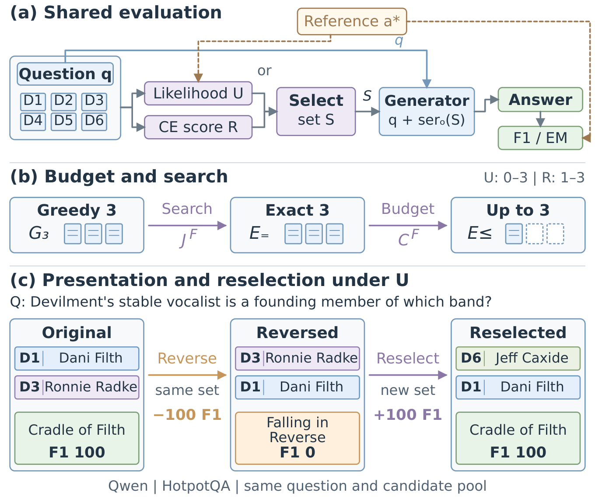

# From Evidence Scores to RAG Answers: Budget, Search, and Presentation

**Wenzhang Du** · [Open Research Reports](https://dqswordman.github.io/open-research/) · November 2026

A different answer can come from choosing fewer passages, choosing different passages or reading them in a different order. On 539 multi-hop questions, allowing shorter contexts accounts for 4.79 of Mistral’s 5.91 token-F1 points of improvement. The released answers let you trace each change separately.

[Manuscript PDF](paper/manuscript.pdf) · [Technical report](https://dqswordman.github.io/technical-reports/rag-evidence-selection-paths/) · [中文技术报告](https://dqswordman.github.io/zh/technical-reports/rag-evidence-selection-paths/) · [Interactive explorer](https://huggingface.co/spaces/DQSWORDMAN/rag-evidence-selection-paths) · [Download v1.0.1](https://github.com/dqswordman/rag-evidence-selection-paths/releases/tag/v1.0.1)



## Read the evidence

First compare greedy and exhaustive selection at exactly three passages from six, then allow fewer. A separate 30-question comparison reverses the same selected passages before permitting a new selection. Selection uses reference-answer likelihood. The reported token F1 comes from the saved generated answers.

| Result | Open the evidence |
| --- | --- |
| Budget and search · Table 2 | [Frozen records](data/analysis/A_role_answers.csv) · [Analysis or reference](reference/budget_search_539.csv) |
| Answer surface and coverage | [Frozen records](data/freeze/old_answers.jsonl.gz) · [Analysis or reference](reference/coverage_per_pool.csv) |
| Order and reselection · Figure 1 | [Frozen records](data/analysis/B_answers_42.jsonl.gz) · [Analysis or reference](scripts/replay_figure1.py) |

## Reproduce on CPU

From the extracted release, run the following with Python 3.12. Results go into an empty directory of your choice.

```sh
python -m pip install -r requirements.txt
python -B verify_manifest.py
python -B reproduce.py --out replay
```

For one worked example, run `python -B scripts/replay_figure1.py`. The [reproduction guide](docs/reproduction.md) maps files to scientific claims. Both technical reports are available offline in [English](docs/report.en.md) and [中文](docs/report.zh.md).

## Method implementation

The [selection code](methods/eug_core.py) enumerates the 64 subsets of six passages and scores a selection by its gap to the best feasible subset. The CPU check uses two saved score arrays to recover the selected passages before and after reversing their order. The [model loader and batch scorer](methods/eug_inference.py) and [generation routine](methods/eug_generation.py) support new inference with the separately obtained pinned checkpoints.

```sh
python -B check_methods.py
```

## Cite and reuse

Wenzhang Du (2026). *From Evidence Scores to RAG Answers: Budget, Search, and Presentation*. Open Research Reports, v1.0.1. [Manuscript](https://dqswordman.github.io/assets/reports/rag-evidence-selection-paths/manuscript.pdf). [Machine-readable citation](CITATION.cff) · [BibTeX](citation.bib)

Wenzhang Du is the sole author. The attached PDF preserves the supplied anonymous title page. Original software uses the [MIT License](LICENSE). The author’s original report, figures, constructed data and measurements use [CC BY 4.0](licenses/CC-BY-4.0.txt). Third-party material retains its own terms and attribution. [Source notices](THIRD_PARTY_NOTICES.md)
