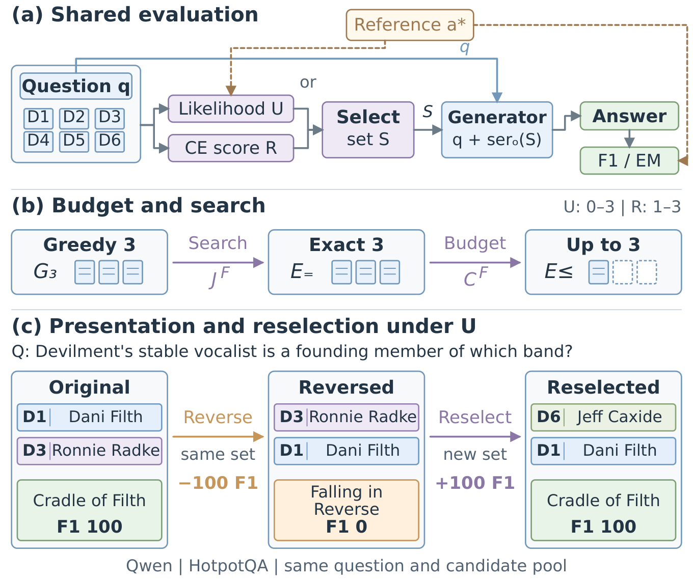

# Which evidence decision changed the answer?

From Evidence Scores to RAG Answers: Budget, Search, and Presentation

Wenzhang Du · Open Research Reports · v1.0.0 · 2026-11-21

Two selection paths separate passage budget, combination search and presentation order. A saved answer at each step shows where an apparent gain originates.

[Original PDF](../paper/manuscript.pdf) · [Online report](https://dqswordman.github.io/technical-reports/rag-evidence-selection-paths/)

## One question, three answers

The question asks which band was founded by Devilment’s eventual vocalist. With the selected passages in their original order, Qwen answers “Cradle of Filth.” Present the same two passages in reverse and its answer becomes “Falling in Reverse.” Select again under the reversed scoring order and the answer returns to “Cradle of Filth.” Comparing the first and last answers alone hides both transitions.



Figure 1 follows the same question across the original, reversed and reselected evidence. Passage identities travel with the selected set.

## Hold the passage pool fixed

Each pool contains six passages. Greedy selection adds a passage three times. Exact search tries all three-passage combinations. Relaxing the budget then permits zero, one or two passages as well. The two differences isolate the contribution of search at a fixed size and the contribution of size flexibility. Scoring uses the likelihood of the reference answer; saved generations give a separate token-F1 readout.

The 539-question panel spans HotpotQA, 2WikiMultiHopQA and MuSiQue, with two pool constructions for each question. The analysis averages the two tracks within question before estimating uncertainty. A nested panel of 89 questions has all 64 canonical subset answers for Qwen and Gemma. On 30 matched questions, each of the 42 sets of size at most three has an answer in both orders.

## Budget flexibility helps one generator most

Mistral gains 5.91 token-F1 points along the full path. Allowing shorter contexts contributes 4.79 points, with a paired 95% interval from 3.12 to 6.53. Searching more thoroughly while keeping three passages contributes 1.11 points. For Qwen and Gemma the intervals for budget flexibility include zero. Each component below is rounded independently.

Table 2 of the manuscript. Paired changes in token-F1 points on 539 questions.

| Generator | Budget | Search | Total |
| --- | --- | --- | --- |
| Qwen | −1.46 | −0.35 | −1.81 |
| Gemma | +0.95 | +0.65 | +1.60 |
| Mistral | +4.79 | +1.11 | +5.91 |

[Source table](https://github.com/dqswordman/rag-evidence-selection-paths/blob/v1.0.0/data/analysis/A_bootstrap_summary.csv)

## The same membership change can switch sign

On the 30-question exact-three panel, reversing Gemma’s original set costs 20.56 points. Reselecting under reverse order recovers 16.54. Placing that newly selected membership in canonical order instead costs 23.35 points relative to the original set. The four crossed readouts reveal an interaction between membership and order.

An answer-blind cross-encoder offers a check on a different selection objective. On the 89 retrieval-built pools, greedy and exact three-passage search choose identical sets in 75 cases. The observed answer changes still differ by generator. The size of the pool, the short-answer format and the single reversal bound the interpretation.

## Reconstruct the result on CPU

On CPU the release re-scores archived generations, checks 9,702 selected-answer records and recomputes 279 paired statistics. It includes passage identifiers and text hashes for joining the original benchmarks. Original benchmark sources supply the passage bodies.

```sh
python -B verify_manifest.py
python -B reproduce.py --out replay
```

## Citation and materials

[Original manuscript · PDF](https://dqswordman.github.io/assets/reports/rag-evidence-selection-paths/manuscript.pdf) · [Frozen release and checksums](https://github.com/dqswordman/rag-evidence-selection-paths/releases/tag/v1.0.0) · [Result map and reproduction scope](https://github.com/dqswordman/rag-evidence-selection-paths/blob/v1.0.0/docs/reproduction.md) · [Interactive evidence explorer](https://huggingface.co/spaces/DQSWORDMAN/rag-evidence-selection-paths)
