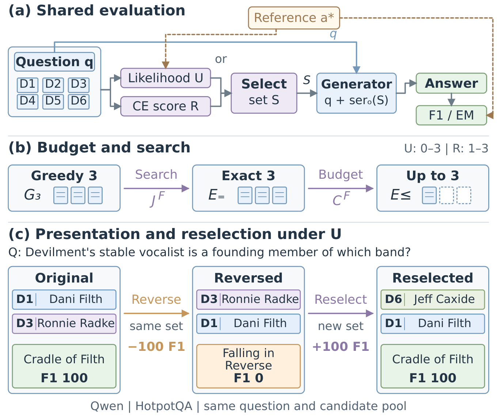

# 哪一步证据选择改变了 RAG 的答案？

From Evidence Scores to RAG Answers: Budget, Search, and Presentation

Wenzhang Du · 开放研究报告 · v1.0.0 · 2026-11-21

沿两条配对路径，分别改变段落预算、组合搜索和呈现顺序。每一步都有已保存的回答，可以追查最终得分从哪里来。

[原版 PDF](../paper/manuscript.pdf) · [在线报告](https://dqswordman.github.io/zh/technical-reports/rag-evidence-selection-paths/)

## 一道问题的三次作答

题目问的是，后来担任 Devilment 主唱的人创立过哪支乐队。Qwen 按原顺序读取选中的两段材料，答出 Cradle of Filth。把相同材料倒过来，答案变成 Falling in Reverse。按反序下的评分重新选择材料，答案又回到 Cradle of Filth。只比较起点与终点，看不到中间发生的两次变化。



图 1 沿同一道题跟踪原顺序、反序及重选。段落编号标明每一步实际使用的证据。

## 先固定候选段落

每个池固定六段候选。贪心方案逐次加入一段，共选三次。精确搜索遍历所有三段组合。随后放宽预算，允许使用零段、一段或两段。两个相邻差值分别衡量固定长度时的搜索变化，以及允许更短上下文带来的变化。选择依据是参考答案的似然，另用已生成答案计算 token F1。

539 道题来自三个多跳问答基准，每题有两种候选池构造。统计先在同一问题内平均两条轨道，再估计不确定性。嵌套的 89 道题保存了 Qwen 和 Gemma 对全部 64 个子集的常规顺序回答。另有 30 道配对题，最多三段的 42 种组合均有两种顺序的回答。

## 放宽预算对哪种模型帮助最大

Mistral 在整条路径上提高 5.91 个 token-F1 点。其中，允许用更短的上下文贡献 4.79 点，配对 95% 区间为 3.12 至 6.53。保持三段、加强搜索贡献 1.11 点。Qwen 和 Gemma 的预算效应区间都覆盖零。下表各项分别取整。

原稿表 2。539 道题上的配对 token-F1 点数变化。

| 生成器 | 预算 | 搜索 | 总变化 |
| --- | --- | --- | --- |
| Qwen | −1.46 | −0.35 | −1.81 |
| Gemma | +0.95 | +0.65 | +1.60 |
| Mistral | +4.79 | +1.11 | +5.91 |

[数据来源](https://github.com/dqswordman/rag-evidence-selection-paths/blob/v1.0.0/data/analysis/A_bootstrap_summary.csv)

## 同一组替换，顺序不同，效应会反向

在 30 道题、精确选三段的设置下，直接反转 Gemma 原来的集合使 F1 下降 20.56 点。按反序重新选择可回升 16.54 点；把重选集合放回常规顺序，相对原集合却下降 23.35 点。四种交叉读数显示，成员替换的效果取决于排列顺序。

另用无需参考答案的交叉编码器检查不同选择目标。在 89 个检索构造的池中，贪心与精确搜索有 75 次选中相同三段，实际答案变化仍因生成器而异。候选池大小、短答案形式及单一反序限定了结论的范围。

## 用 CPU 重建结果

CPU 回放重新计算归档回答的分数，核验 9,702 条选中答案，并重算 279 项配对统计。包内保存段落标识和文本哈希，可回到上游基准核对段落正文。

```sh
python -B verify_manifest.py
python -B reproduce.py --out replay
```

## 引用与材料

[原版论文 · PDF](https://dqswordman.github.io/assets/reports/rag-evidence-selection-paths/manuscript.pdf) · [固定版本与校验值](https://github.com/dqswordman/rag-evidence-selection-paths/releases/tag/v1.0.0) · [结果映射与复现范围](https://github.com/dqswordman/rag-evidence-selection-paths/blob/v1.0.0/docs/reproduction.md) · [交互式证据浏览](https://huggingface.co/spaces/DQSWORDMAN/rag-evidence-selection-paths)
